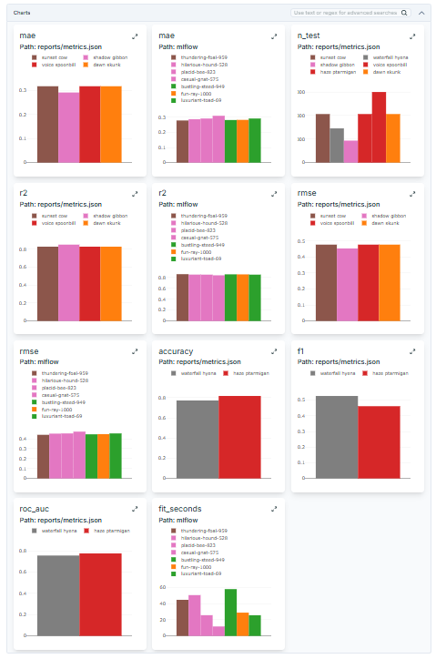
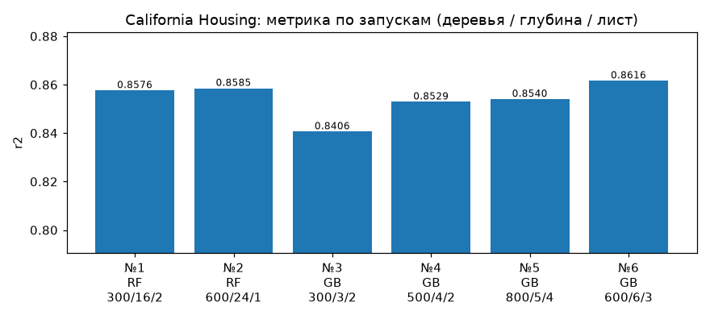

# MLOps ЛР1 — вариант 5, California Housing

## Постановка

Регрессия: предсказание медианной стоимости жилья (MedHouseVal, единицы 100 000 USD).

- v1: северные районы (Latitude >= 35.0) — обучающий срез.
- v2: все районы.
- Поток для ЛР4: южные районы (Latitude < 35.0).

## Развёртывание

    pip install uv
    uv lock
    uv export --frozen --no-hashes -o requirements.lock.txt
    pip install -r requirements.lock.txt
    dvc pull
    dvc repro

## Пайплайн

prepare -> featurize -> train -> evaluate, описан в dvc.yaml.

- Граф: dvc dag
- Метрики: reports/metrics.json

## Результаты

| Версия | R2 | MAE | RMSE | n_test |
|---|---|---|---|---|
| v1 (north) | 0.8529 | 0.292 | 0.454 | 1870 |
| v2 (all) | 0.8300 | 0.318 | 0.478 | 4128 |

R2 на v2 ниже, потому что в полный набор входят южные районы с другим распределением цен; модель, обученная на северном срезе, на них обобщается хуже.

## Версии данных

- data-v1 — северные районы
- data-v2 — все районы

Возврат к v1:

    git checkout data-v1 && dvc checkout && dvc repro

## Окружение

Зафиксировано в uv.lock, разворачивается через uv export и pip install.

## Сценарий смены версии данных

1. v1 (north): `python -m src.ingest --version north`, `dvc add`, `dvc push`, `dvc repro` → r2 0.8529, n_test 1870. Зафиксировано тегом `data-v1`.
2. v2 (all): `python -m src.ingest --version all`, `dvc add`, `dvc push`, `dvc repro` → r2 0.8300, n_test 4128. Зафиксировано тегом `data-v2`.
3. Возврат: `git checkout data-v1 && dvc checkout && dvc repro` → снова r2 0.8529, n_test 1870.

## Сравнение моделей (дополнительное задание)

Модель задаётся в `params.yaml` полем `train.model`. Код `src/train.py` не менялся — `make_model` выбирает класс по имени.

| Модель | R2 | MAE | RMSE | n_test |
|---|---|---|---|---|
| gradient_boosting (базовая) | 0.8300 | 0.318 | 0.478 | 4128 |
| random_forest | 0.5995 | 0.540 | 0.734 | 4128 |

RandomForest с `n_estimators=500`, `max_depth=4`, `min_samples_leaf=2` показал R2 заметно ниже, чем GradientBoosting: бустинг последовательно исправляет ошибки предыдущих деревьев и лучше улавливает нелинейности, тогда как случайный лес с малой глубиной усредняет независимые деревья и на этом наборе обобщает слабее. При этом RandomForest не прошёл порог `evaluate.min_r2: 0.60` (R2 = 0.5995), и этап `evaluate` завершился с ошибкой — это ожидаемое поведение проверки качества.

Переключение модели выполняется только правкой `params.yaml`; `dvc repro` пересчитывает `train` и `evaluate`, не трогая `prepare` и `featurize`.

## Проверка воспроизводимости (дополнительное задание)

Два прогона пайплайна с принудительным пересчётом (`dvc repro --force`) дают одинаковые метрики:

| Прогон | R2 | MAE | RMSE | n_test |
|---|---|---|---|---|
| 1 | 0.8300 | 0.318 | 0.478 | 4128 |
| 2 | 0.8300 | 0.318 | 0.478 | 4128 |

Совпадение точное (`m1 == m2`), а также в пределах допуска `1e-4`. Это подтверждает детерминированность пайплайна: seed задан в `params.yaml`, разбиение и обучение не зависят от состояния кэша. Автоматическая проверка — `tests/test_reproducibility.py` (три теста, `pytest -q`).

## ЛР2. Эксперименты и реестр моделей

**Эксперимент в DagsHub:** https://dagshub.com/dazzlaxx/mlops/experiments

**Модель в реестре:** `california-housing-regressor`

- champion: версия **1**, r2 = 0.8616
- challenger: версия **2**, r2 = 0.8406

### Запуски

Данные: северные районы (`Latitude >= 35.0`), 1870 строк в тесте; случайное разбиение 80/20, seed 42. Все запуски выполнены командой `dvc repro -f`, параметры менялись только в `params.yaml`.

|   № | Модель            | Деревья / глубина / лист   | learning_rate   |     R² |   MAE |   RMSE |   Время, с | run      |
|----:|:------------------|:---------------------------|:----------------|-------:|------:|-------:|-----------:|:---------|
|   1 | random_forest     | 300 / 16 / 2               | -               | 0.8576 | 0.283 |  0.447 |         61 | bddaa2f8 |
|   2 | random_forest     | 600 / 24 / 1               | -               | 0.8585 | 0.282 |  0.445 |        168 | 4d7a037c |
|   3 | gradient_boosting | 300 / 3 / 2                | 0.1             | 0.8406 | 0.31  |  0.472 |         36 | 24474a28 |
|   4 | gradient_boosting | 500 / 4 / 2                | 0.1             | 0.8529 | 0.292 |  0.454 |         49 | fa092b12 |
|   5 | gradient_boosting | 800 / 5 / 4                | 0.1             | 0.854  | 0.287 |  0.452 |         73 | c5bb444f |
|   6 | gradient_boosting | 600 / 6 / 3                | 0.05            | 0.8616 | 0.279 |  0.44  |         69 | 3dfece42 |

### Выводы

- Лучший — запуск №6 (gradient_boosting 600/6/3): r2 = 0.8616, MAE = 0.279, RMSE = 0.440.
- Худший — запуск №3 (gradient_boosting 300/3/2): r2 = 0.8406; разброс по серии 0.0210.
- Лучшее по семействам: gradient_boosting — 0.8616, random_forest — 0.8585; разница 0.0031: семейства моделей близки по качеству.
- Запуск №5 сложнее лучшего (gradient_boosting 800/5/4), но не лучше: 0.8540 против 0.8616, время 73.0 с против 68.7 с — наращивать сложность дальше смысла нет.

### Выбор модели

В `params.yaml` закреплена конфигурация gradient_boosting 600/6/3 (learning_rate 0.05): лучший r2 = 0.8616. Она же даёт наименьшие MAE и RMSE в серии. Она зарегистрирована как версия реестра и стала `champion`; кандидаты становятся `champion` только по правилу «метрика строго лучше».

### Реестр

|   version | aliases    |     r2 |
|----------:|:-----------|-------:|
|         1 | champion   | 0.8616 |
|         2 | challenger | 0.8406 |

Слабый кандидат (худший запуск серии) зарегистрирован как `challenger` и `champion` не заменил — правило продвижения работает.

### Как повторить

    python -m dvc repro -f                 # новый запуск в MLflow
    python -m src.registry register        # версия -> challenger
    python -m src.registry promote         # challenger лучше champion -> алиас
    python -m src.registry status          # версии и алиасы

Загрузка модели без пути к файлу:

    mlflow.sklearn.load_model('models:/california-housing-regressor@champion')
